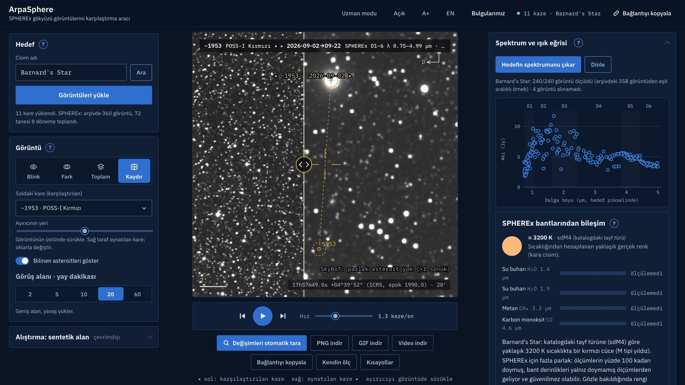
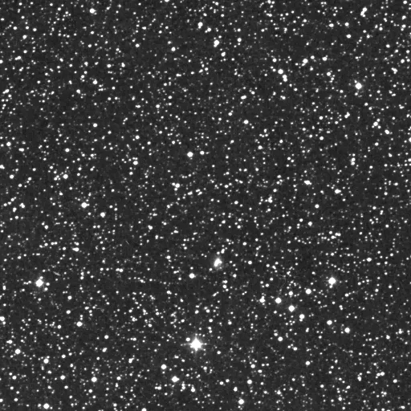
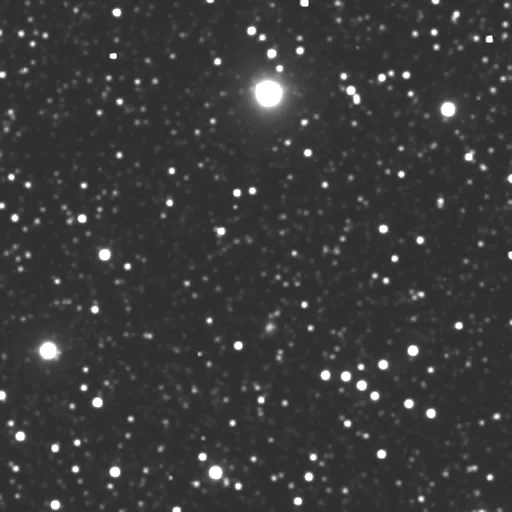

# ArpaSphere

ArpaSphere finds, measures and verifies moving and changing objects in sky archives. It aligns photographic sky surveys from 1953 onward with the 102-band infrared images of NASA's SPHEREx mission and runs entirely in the browser.

**Live:** [sphere.arpama.tr](https://sphere.arpama.tr) · **Overview:** [explain.arpama.tr](https://explain.arpama.tr) · Built for the NASA Space Apps Challenge 2026



| 1953 · POSS-I | 2026 · SPHEREx |
|:---:|:---:|
|  |  |

## Features

- **Blink, difference, stack and swipe views** of archival and SPHEREx frames resampled onto one sky grid.
- **Proper motion from SPHEREx alone.** The target is centroided in every frame and a weighted line is fitted to position versus time, with an uncertainty and a plot.
- **Automatic change scan.** Every star in the field is tracked; moving, appearing, vanishing and single-epoch sources are listed, moving ones are checked against Gaia DR3, and results export to CSV.
- **Click-to-measure** for any source in the image, and a two-click manual measurement mode for teaching.
- **102-band spectra** from aperture photometry on every SPHEREx image, with light curves, period search, water, methane and CO band depths, and spectral-type estimates from 65 reference objects (K0–T7.5).
- **Live archive view** of new SPHEREx data arriving at NASA/IPAC IRSA each week.
- **Context layers:** Aladin Lite sky atlas, Gaia DR3 and CatWISE2020 overlays, SkyBoT asteroid check, NEOSSat and CADC archives.
- **Name resolution** from a local catalogue of 156,000 stars and dwarfs (HYG, Gaia DR3 within 50 pc, UltracoolSheet), falling back to SIMBAD/Sesame for proper motion, parallax and type.
- Turkish and English interface, light and dark themes, a guided tour, PNG/GIF/video export and shareable links.

## Validation

| Test | Result |
|---|---|
| Proper motion from SPHEREx only, stars of known speed | 26 of 27 reliable measurements agree with the catalogue within 2σ; median difference 11 %, direction 7°, r = 0.91 |
| Barnard's Star | 10.4 ± 0.8″/yr (catalogue 10.39″/yr) |
| ε Indi B flux, 1.15–1.35 µm | 27.1 mJy measured, 27.7 mJy expected |
| Spectral type, M dwarfs | ±0.89 subtypes (leave-one-out) |
| Cepheid HV 1002 (LMC) | Period 30.5 d (known 30.48 d) |
| Methane band, 47 T/Y dwarfs | Spearman ρ = 0.69 with catalogue type |

Full tables: [sphere.arpama.tr/bulgular](https://sphere.arpama.tr/bulgular.html).

**Limitations.** SPHEREx pixels are 6.2″ and its baseline is about one year, so motions slower than about 2″/yr cannot be measured from SPHEREx alone. Plate epochs are uncertain by 1–2 years. Bright stars saturate in SPHEREx. Automatically detected sources are candidates until confirmed.

## Architecture

```
Browser (site/)                         Cloudflare Worker (worker/)           Public archives
FITS parsing, resampling, masking   →   request validation, CORS,         →   NASA/IPAC IRSA (SPHEREx, Gaia, CatWISE)
stacking, tracking, photometry,         HTTP range reads of only the          STScI DSS, Pan-STARRS, SkyView
spectra, classification                 bytes needed, edge caching            IMCCE SkyBoT, CADC, CDS Sesame/SIMBAD
```

All image processing and measurement run client-side. The Worker exists because the archives do not allow direct browser access; for a ~70 MB SPHEREx file it reads only the header and the rows around the target.

| Endpoint | Returns |
|---|---|
| `GET /api/spherex/ara?ra&dec` | SPHEREx images covering a position (IRSA SIA) |
| `GET /api/spherex/kesit?url&ra&dec&size` | FITS cutout (IMAGE, FLAGS, VARIANCE, ZODI) |
| `GET /api/spherex/foto?url&ra&dec` | Aperture photometry (µJy) and wavelength at the target |
| `GET /api/spherex/dalga?url&ra&dec` | Detector wavelength table |
| `GET /api/katalog?k=gaia\|catwise&ra&dec&r` | Gaia DR3 or CatWISE2020 sources with proper motions |
| `GET /api/kesif?ra&dec&r&pm` | Fast CatWISE sources classified against Gaia and SIMBAD |
| `GET /api/coz?ad` | Name resolution: position, proper motion, parallax, type |
| `GET /api/skybot?ra&dec&r&t` | Known minor bodies in the field at a given time |
| `GET /api/canli` | Current state of the SPHEREx archive |
| `GET /api/neossat/…`, `/api/cadc/…` | NEOSSat and CADC observations |
| `GET /api/hips/…` | IRSA HiPS mirror for Aladin Lite |

## Repository layout

```
site/       Web app (index.html), findings page, catalogues and result data, English strings
worker/     Cloudflare Worker: archive proxy, S3 range reader, live archive status
tanitim/    Project overview page served at explain.arpama.tr
araclar/    Scripts that build the catalogues, translations, type templates and validation data
docs/       Images used in this README
```

## Getting started

Requirements: Node.js 18+ and, for deployment, a Cloudflare account.

```bash
npx wrangler dev        # run locally
npx wrangler deploy     # deploy site and Worker
```

The overview page is generated from `araclar/tanitim_sablon.html`:

```bash
python3 araclar/tanitim_uret.py
cd tanitim && npx wrangler deploy
```

To rebuild the star catalogue, place [HYG Database v4.2](https://github.com/astronexus/HYG-Database) as `veri/hygdata_v42.csv.gz` and run `python3 -I araclar/katalog_uret.py`. Usage for the other scripts is documented at the top of each file.

No API keys are stored in this repository. The optional text-to-speech endpoint reads `ELEVENLABS_API_KEY` from a Cloudflare secret (`npx wrangler secret put ELEVENLABS_API_KEY`).

## Data and credits

- **Imaging:** NASA SPHEREx (NASA/IPAC IRSA), STScI Digitized Sky Survey and Pan-STARRS, legacysurvey.org, NASA SkyView, NEOSSat (Canadian Space Agency, via CADC).
- **Catalogues:** ESA Gaia DR3, CatWISE2020 (IRSA), [HYG Database v4.2](https://github.com/astronexus/HYG-Database) (CC BY-SA 4.0), [The UltracoolSheet](https://doi.org/10.5281/zenodo.4169084) v2.1.0 by Best, Dupuy, Liu et al. (CC BY 4.0).
- **Services:** CDS Sesame/SIMBAD, IMCCE SkyBoT, Aladin Lite (CDS).

## Team

Sertaç · Mert · Güven · Kerim · Kağan

ArpaSphere is an independent student project. It is not affiliated with or endorsed by NASA.

---

## Türkçe

ArpaSphere, gökyüzü arşivlerinde hareket eden ve değişen cisimleri bulan, ölçen ve doğrulayan bir tarayıcı aracıdır. 1953'ten bu yana çekilmiş fotoğraf plaklarını NASA'nın SPHEREx görevinin 102 bantlı kızılötesi görüntüleriyle aynı gökyüzü ızgarasında üst üste koyar.

Başlıca özellikleri şunlar:
- Blink, fark, toplam ve kaydırma görünümleri.
- Yalnız SPHEREx karelerinden öz hareket ölçümü.
- Gaia DR3 ile sınanan otomatik değişim taraması.
- 102 bantta spektrum, bileşim ve tür tahmini.
- SPHEREx arşivinin canlı görünümü.

Hızı bilinen yıldızlarda güvenilir 27 ölçümün 26'sı katalogla 2σ içinde uyumludur. Arayüz Türkçe ve İngilizcedir: [sphere.arpama.tr](https://sphere.arpama.tr).
